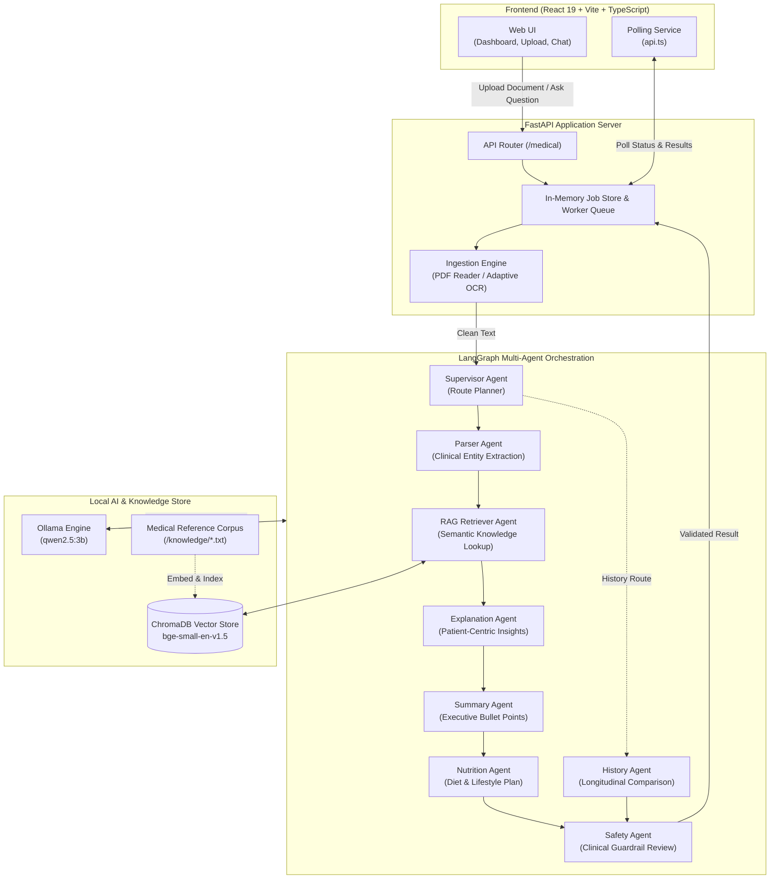
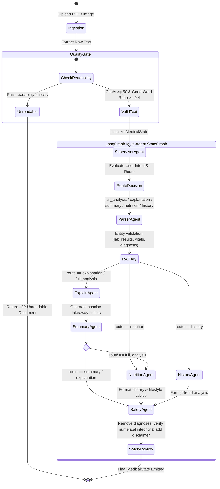
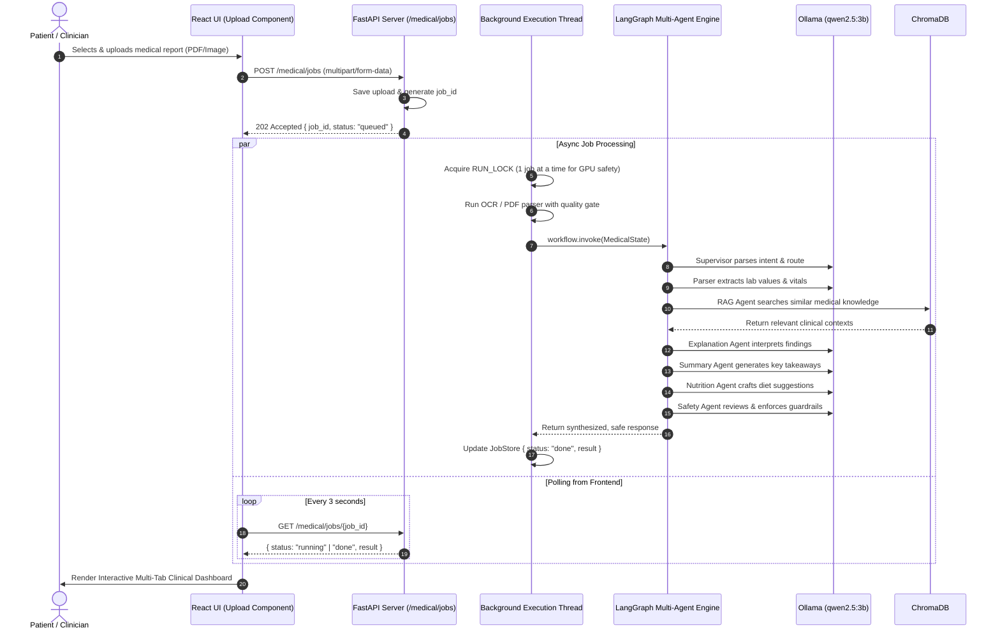

# MediAssist AI — Intelligent Clinical Document Analyzer & Multi-Agent Diagnostic Assistant

[](https://fastapi.tiangolo.com)
[](https://github.com/langchain-ai/langgraph)
[](https://ollama.com)
[](https://www.trychroma.com/)
[](https://react.dev)
[](https://www.typescriptlang.org)
[](https://vitejs.dev)

MediAssist AI is an end-to-end, privacy-preserving clinical document analysis and medical question-answering system. Powered by **LangGraph multi-agent orchestration**, **grounded Retrieval-Augmented Generation (RAG)**, **Ollama local language models (`qwen2.5:3b`)**, and an adaptive **OCR/PDF ingestion pipeline**, MediAssist AI turns complex medical reports, blood tests, and lab scans into structured, patient-friendly explanations, executive summaries, nutrition/lifestyle guidance, and longitudinal comparisons — all governed by clinical safety guardrails.

---

## 📑 Table of Contents

- [Key Features](#-key-features)
- [Complete Flow Architecture](#-complete-flow-architecture)
  - [1. High-Level System Architecture](#1-high-level-system-architecture)
  - [2. LangGraph Multi-Agent Workflow](#2-langgraph-multi-agent-workflow)
  - [3. End-to-End Sequence & Polling Flow](#3-end-to-end-sequence--polling-flow)
- [Multi-Agent System Deep Dive](#-multi-agent-system-deep-dive)
- [Document Ingestion & Preprocessing Pipeline](#-document-ingestion--preprocessing-pipeline)
- [Medical Knowledge Base & RAG System](#-medical-knowledge-base--rag-system)
- [Project Directory Structure](#-project-directory-structure)
- [Technology Stack](#-technology-stack)
- [Installation & Getting Started](#-installation--getting-started)
  - [Prerequisites](#prerequisites)
  - [1. Ollama Model Setup](#1-ollama-model-setup)
  - [2. Tesseract OCR Setup](#2-tesseract-ocr-setup)
  - [3. Backend Setup](#3-backend-setup)
  - [4. Vector Database Build](#4-vector-database-build)
  - [5. Frontend Setup](#5-frontend-setup)
- [API Reference](#-api-reference)
- [Clinical Safety & Anti-Hallucination Guardrails](#-clinical-safety--anti-hallucination-guardrails)
- [Medical Disclaimer](#-medical-disclaimer)

---

## 🌟 Key Features

- **Multi-Format Ingestion**: Ingests digital PDFs via native text extractors and paper scans/photos via adaptive Tesseract OCR (with automatic 4-angle rotation, CLAHE contrast enhancement, and adaptive thresholding) or local Vision-Language Models (VLM).
- **Quality Gating**: Automatic readability heuristics prevent garbage-in garbage-out by flagging corrupted or illegible uploads upfront.
- **LangGraph Multi-Agent Orchestration**: Modular, stateful workflow graph with designated agents for routing, entity parsing, RAG retrieval, clinical explanation, executive summaries, nutrition guidance, history comparison, and safety verification.
- **Strict Anti-Hallucination Prompts**: Agents are constrained to extract and explain *only* values present in the source report or verified medical knowledge, eliminating fabricated numbers or ungrounded diagnoses.
- **Grounded Semantic RAG**: ChromaDB vector store powered by `BAAI/bge-small-en-v1.5` embeddings, indexed with extensive evidence-based medical knowledge covering CBC, metabolic profiles, renal function, liver enzymes, lipid panels, electrolytes, thyroid, and vitamins.
- **Asynchronous Polling Engine**: Dual-mode backend offering synchronous `/upload` as well as asynchronous job creation (`/jobs`) with background queueing and polling, preventing HTTP timeout issues across proxies or tunnel environments.
- **Modern Interactive Dashboard**: React 19 + TypeScript frontend with drag-and-drop file upload, live status notifications, multi-tab clinical dashboard, and contextual follow-up chat.
- **100% Privacy & Local Compute**: Runs entirely on local hardware through Ollama and embedded vector stores — no patient data leaves your machine.

---

## 🏛 Complete Flow Architecture

### 1. High-Level System Architecture



---

### 2. LangGraph Multi-Agent Workflow



---

### 3. End-to-End Sequence & Polling Flow



---

## 🤖 Multi-Agent System Deep Dive

MediAssist AI leverages LangGraph's `StateGraph` backed by an in-memory `MemorySaver` checkpointer. Each agent operates with specific roles, strict prompting rules, and bounded context:

| Agent Node | Primary Role | Rules & Anti-Hallucination Guardrails |
| :--- | :--- | :--- |
| **Supervisor Agent** | Intent classification and routing | Uses whole-word regular expressions (`HISTORY_PATTERN`, `NUTRITION_PATTERN`, `SUMMARY_PATTERN`) and explicit `full_analysis` flags to avoid routing confusion (e.g. distinguishing *explanation* from *plan*). |
| **Parser Agent** | Structural extraction | Extracts entities into typed JSON (`lab_results`, `vitals`, `diagnosis`, `medications`, `recommendations`). Validates clinical presence before allowing downstream execution. |
| **RAG Agent** | Medical context augmentation | Semantic query search over ChromaDB with query truncation and relevance deduplication. Skips retrieval for generic questions to prevent ungrounded context injection. |
| **Explanation Agent** | Plain-language clinical interpretation | Explains abnormal values, potential conditions, and terms. Strict rule: never invent numbers or test names; copies names/dates verbatim; states "Not stated" when missing. |
| **Summary Agent** | Executive bullet points | Max 6 patient-friendly bullet points summarizing document type, primary findings, and clinician notes. Strictly forbidden from providing unsolicited reassurance. |
| **Nutrition Agent** | Evidence-based lifestyle guidance | Recommends dietary and lifestyle modifications strictly tailored to identified conditions (e.g., iron-rich foods for anemia, low glycemic items for HbA1c elevation). Falls back to generic healthy habits if no nutrition markers exist. |
| **History Agent** | Longitudinal trend analysis | Compares previous report with current report, tracking absolute numerical delta and indicating whether values increased, decreased, or remained stable. |
| **Safety Agent** | Final clinical guardrail & validation | Reviews all generated outputs: strips unsupported definitive diagnoses, ensures numerical precision, flags critical red flags requiring emergency care, and appends statutory clinical disclaimers. |

---

## 🔬 Document Ingestion & Preprocessing Pipeline

MediAssist AI supports both native digital documents and imperfect mobile phone captures:

1. **PDF Documents**:
   - Processed via `pypdf` / `pdfplumber`.
   - Text length validation ensures the document contains selectable text (not an empty scan).
2. **Scanned Images & Photos (JPG/PNG)**:
   - **EXIF Transposition**: Fixes image orientation based on mobile camera metadata.
   - **Multi-Angle Auto-Rotation**: Evaluates 0°, 90°, 180°, and 270° orientations against Tesseract confidence scores to auto-orient upside-down or sideways photos.
   - **Image Enhancements**:
     - Resolution normalization to 2000px+ via bicubic interpolation.
     - Non-Local Means Denoising (`cv2.fastNlMeansDenoising`).
     - CLAHE (Contrast Limited Adaptive Histogram Equalization).
     - Adaptive Gaussian Thresholding for optimal binarization.
   - **Quality Gate Filter**: Enforces word count thresholds ($\ge 15$ valid dictionary words) and confidence ratios ($\ge 0.40$). Illegible photos trigger an early `422 Unreadable` response.
   - **Optional Vision LLM Mode**: Supports local OCR via vision-language models such as `qwen2.5vl:7b` through Ollama.

---

## 📚 Medical Knowledge Base & RAG System

The RAG subsystem references a structured collection of curated medical topics located in `backend/app/knowledge/`:

- **Complete Blood Count (CBC)**: Hemoglobin, White Blood Cells (WBC), Platelets, Ferritin, Anemia, Iron Deficiency.
- **Metabolic & Diabetes**: Fasting Blood Glucose, HbA1c, Diabetes Management.
- **Cardiovascular & Lipids**: Blood Pressure, Hypertension, Total Cholesterol, HDL, LDL, Triglycerides.
- **Renal & Liver Function**: Creatinine, Uric Acid, Kidney Health, ALT, AST, Liver Profiles.
- **Endocrine & Micronutrients**: TSH, T3, T4, Thyroid Function, Electrolytes (Sodium, Potassium, Calcium), Vitamin D, Vitamin B12.

Each document is segmented using `RecursiveCharacterTextSplitter` ($chunk\_size=500$, $overlap=50$) and embedded using `BAAI/bge-small-en-v1.5` into a local ChromaDB instance (`backend/app/vector_db`).

---

## 📁 Project Directory Structure

```text
MediAssist-AI/
├── Medical-AI/
│   ├── backend/
│   │   ├── app/
│   │   │   ├── agents/                     # LangGraph Agent Implementations
│   │   │   │   ├── analyzer_agent.py       # Clinical finding analyzer
│   │   │   │   ├── explanation_agent.py    # Detailed plain-language explanation
│   │   │   │   ├── history_agent.py        # Longitudinal comparison agent
│   │   │   │   ├── nutrition_agent.py      # Dietary & lifestyle recommendations
│   │   │   │   ├── ocr_agent.py            # Optical character recognition agent
│   │   │   │   ├── parser_agent.py         # Clinical entity parser
│   │   │   │   ├── rag_agent.py            # Context retriever node
│   │   │   │   ├── safety_agent.py         # Guardrail & disclaimer agent
│   │   │   │   ├── summary_agent.py        # Executive summary generator
│   │   │   │   └── supervisor_agent.py     # Intent router and graph entry
│   │   │   ├── api/
│   │   │   │   └── medical.py              # FastAPI routes (/jobs, /upload)
│   │   │   ├── graph/
│   │   │   │   ├── state.py                # MedicalState TypedDict definition
│   │   │   │   └── workflow.py             # Compiled LangGraph state machine
│   │   │   ├── knowledge/                  # Evidence-based medical knowledge texts
│   │   │   ├── parser/
│   │   │   │   └── llm_parser.py           # Few-shot LLM entity extractor
│   │   │   ├── rag/
│   │   │   │   ├── build_vector_db.py      # Knowledge ingestion & Chroma builder
│   │   │   │   ├── embeddings.py           # HuggingFace BGE embeddings
│   │   │   │   └── retriever.py            # ChromaDB similarity retriever
│   │   │   ├── services/
│   │   │   │   ├── ocr_reader.py           # Advanced Tesseract / VLM OCR pipeline
│   │   │   │   └── pdf_reader.py           # Native PDF text extractor
│   │   │   ├── vector_db/                  # Persistent ChromaDB store
│   │   │   └── main.py                     # FastAPI entry point & CORS configuration
│   │   ├── test_workflow.py                # Standalone LangGraph pipeline test
│   │   ├── test_ollama.py                  # Ollama connectivity test
│   │   └── requirements.txt                # Python backend dependencies
│   │
│   └── frontend/
│       ├── public/                         # Public assets & SVG icons
│       ├── src/
│       │   ├── assets/                     # UI graphics & logos
│       │   ├── components/
│       │   │   ├── Chat.tsx                # Contextual follow-up medical chat
│       │   │   ├── Dashboard.tsx           # Multi-tab analysis viewer
│       │   │   └── Upload.tsx              # Drag-and-drop file upload with polling
│       │   ├── services/
│       │   │   └── api.ts                  # Axios client & polling handler
│       │   ├── App.tsx                     # Main layout & view coordinator
│       │   ├── index.css                   # Responsive design & custom CSS variables
│       │   └── main.tsx                    # React DOM root
│       ├── index.html                      # HTML template
│       ├── package.json                    # Frontend dependencies & scripts
│       ├── tsconfig.json                   # TypeScript configuration
│       └── vite.config.ts                  # Vite build configuration
├── .gitignore                              # Git exclusion rules
└── README.md                               # Project documentation
```

---

## 🛠 Technology Stack

### Backend
- **Framework**: [FastAPI](https://fastapi.tiangolo.com/) (ASGI, async background tasks, thread pool execution)
- **Agent Orchestration**: [LangGraph](https://github.com/langchain-ai/langgraph) & [LangChain Core](https://python.langchain.com/)
- **Local Inference**: [Ollama](https://ollama.com/) running `qwen2.5:3b` (primary) and optional `qwen2.5vl:7b` (vision)
- **Vector Database**: [ChromaDB](https://www.trychroma.com/)
- **Embedding Model**: `BAAI/bge-small-en-v1.5` via [SentenceTransformers](https://sbert.net/)
- **Document Processing**: Tesseract OCR, OpenCV (`opencv-python`), Pillow (`PIL`), PyPDF2

### Frontend
- **Framework**: [React 19](https://react.dev) with [TypeScript](https://www.typescriptlang.org)
- **Tooling**: [Vite](https://vitejs.dev)
- **HTTP Client**: [Axios](https://axios-http.com/)
- **Icons**: [Lucide React](https://lucide.dev/)

---

## 🚀 Installation & Getting Started

### Prerequisites

- **Python**: 3.10 or higher
- **Node.js**: v18.0.0 or higher
- **Ollama**: Installed and running locally ([Download Ollama](https://ollama.com/download))
- **Tesseract OCR**: Installed on your system

---

### 1. Ollama Model Setup

Start Ollama and pull the lightweight clinical reasoning model:

```bash
# Pull the primary language model
ollama pull qwen2.5:3b

# (Optional) If you plan to use local vision OCR
ollama pull qwen2.5vl:7b
```

Verify that the model is functioning:
```bash
python Medical-AI/backend/test_ollama.py
```

---

### 2. Tesseract OCR Setup

#### Windows:
1. Download the installer from [UB-Mannheim/tesseract](https://github.com/UB-Mannheim/tesseract/wiki).
2. Install to default directory: `C:\Program Files\Tesseract-OCR\tesseract.exe`.
3. Add `C:\Program Files\Tesseract-OCR` to your system `PATH`.

#### Linux (Ubuntu/Debian):
```bash
sudo apt-get update
sudo apt-get install -y tesseract-ocr libtesseract-dev
```

#### macOS:
```bash
brew install tesseract
```

---

### 3. Backend Setup

1. Open a terminal and navigate to the backend directory:
   ```bash
   cd Medical-AI/backend
   ```

2. Create and activate a virtual environment:
   ```bash
   # Windows (PowerShell)
   python -m venv .venv
   .\.venv\Scripts\Activate.ps1

   # Linux / macOS
   python3 -m venv .venv
   source .venv/bin/activate
   ```

3. Install dependencies:
   ```bash
   pip install -r requirements.txt
   pip install langchain-ollama langgraph chromadb sentence-transformers opencv-python pytesseract pillow
   ```

4. Start the FastAPI development server:
   ```bash
   uvicorn app.main:app --reload --host 127.0.0.1 --port 8000
   ```
   The backend API will be live at `http://127.0.0.1:8000`. You can inspect interactive documentation at `http://127.0.0.1:8000/docs`.

---

### 4. Vector Database Build

The repository includes pre-built vector stores. If you add or modify files in `backend/app/knowledge/`, rebuild the database with:

```bash
cd Medical-AI/backend
python -m app.rag.build_vector_db
```

---

### 5. Frontend Setup

1. Open a second terminal and navigate to the frontend directory:
   ```bash
   cd Medical-AI/frontend
   ```

2. Install dependencies:
   ```bash
   npm install
   ```

3. (Optional) Configure environment variable if connecting to an external or tunneled backend:
   Create a `.env` file in `Medical-AI/frontend/`:
   ```env
   VITE_API_URL=http://localhost:8000
   ```

4. Launch the Vite dev server:
   ```bash
   npm run dev
   ```
   Open your browser at `http://localhost:5173`.

---

## 📡 API Reference

### Health Checks
- **`GET /`**: Verifies API operational status.
- **`GET /health`**: Returns system health status.

### Report Processing (Async / Recommended)
- **`POST /medical/jobs`**
  - **Payload**: `multipart/form-data` with `file` (PDF/JPG/PNG) and optional `question` (string).
  - **Status Code**: `202 Accepted`
  - **Response**:
    ```json
    {
      "job_id": "9b1deb4d-3b7d-4bad-9bdd-2b0d7b3dcb6d",
      "status": "queued"
    }
    ```

- **`GET /medical/jobs/{job_id}`**
  - **Response**:
    ```json
    {
      "job_id": "9b1deb4d-3b7d-4bad-9bdd-2b0d7b3dcb6d",
      "status": "done",
      "result": {
        "report_id": "9b1deb4d-3b7d-4bad-9bdd-2b0d7b3dcb6d",
        "filename": "blood_test.pdf",
        "extraction_method": "pdf",
        "extracted_text": "...",
        "answer": "Detailed clinical explanation...",
        "summary": "1. Normal hemoglobin...",
        "explanation": "Detailed clinical explanation...",
        "nutrition": "Dietary recommendations..."
      },
      "detail": null,
      "http_status": null
    }
    ```

### Report Processing (Synchronous / Direct)
- **`POST /medical/upload`**
  - **Payload**: `multipart/form-data` with `file` and optional `question`.
  - **Status Code**: `200 OK` (blocks until completion).

---

## 🛡 Clinical Safety & Anti-Hallucination Guardrails

MediAssist AI was engineered with healthcare safety at its core:

1. **Defensive Extraction**: The document parser strictly verifies the existence of clinical values. If no recognizable clinical data is found, processing stops with an explicit alert.
2. **Deterministic Fallbacks**: Missing or unreadable values are labeled as *"Not stated"* or *"Not applicable"*; the system never fills gaps with hypothetical numbers.
3. **No Unwarranted Reassurance**: The summary agent mirrors explicit clinical impressions without adding unwarranted phrases like *"no signs of infection"* unless explicitly stated in the source document.
4. **Safety Review Agent**: An automated final-stage validator strips definitive diagnoses, enforces numerical integrity, and attaches standard disclaimers.

---

## ⚠️ Medical Disclaimer

> **IMPORTANT**: MediAssist AI is an artificial intelligence research and informational prototype designed solely for educational, exploratory, and patient literacy purposes. It is **NOT** a certified medical diagnostic device and does **NOT** provide binding medical advice, clinical diagnoses, or treatment prescriptions.
> 
> Laboratory reference ranges, test interpretations, and clinical protocols vary by laboratory and individual health context. Always consult a qualified, licensed healthcare professional or physician regarding any medical test results, symptoms, or health decisions. In case of a medical emergency, immediately contact your local emergency services.

---

## 📄 License

This project is licensed under the [MIT License](LICENSE).
